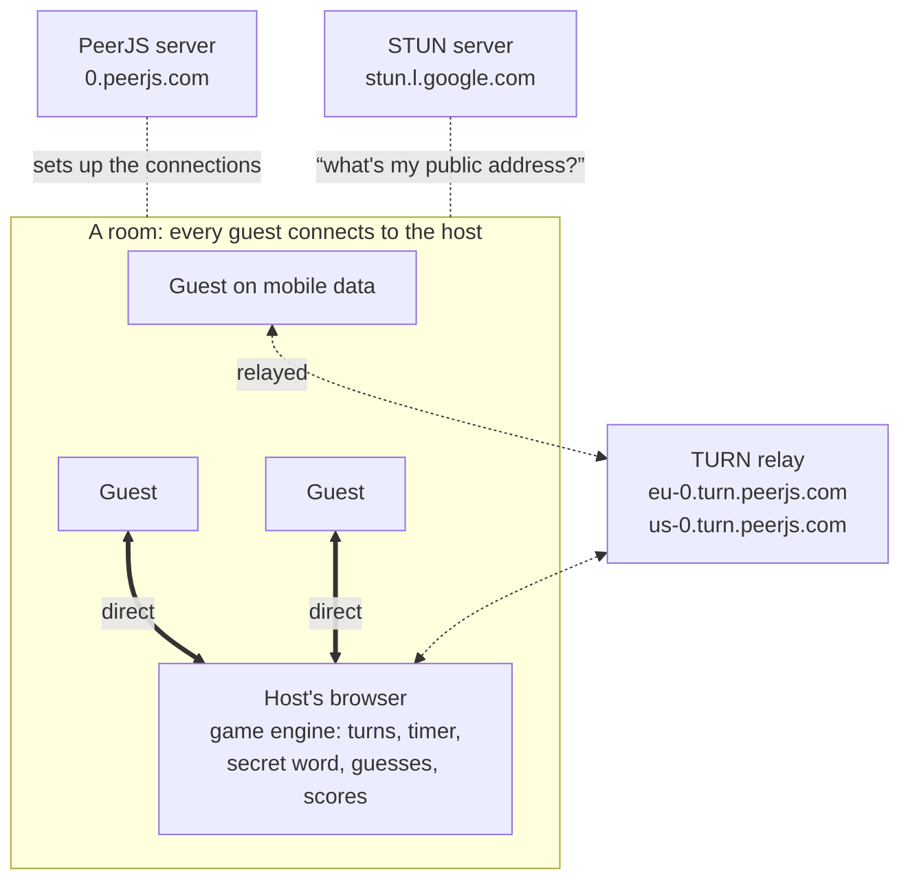
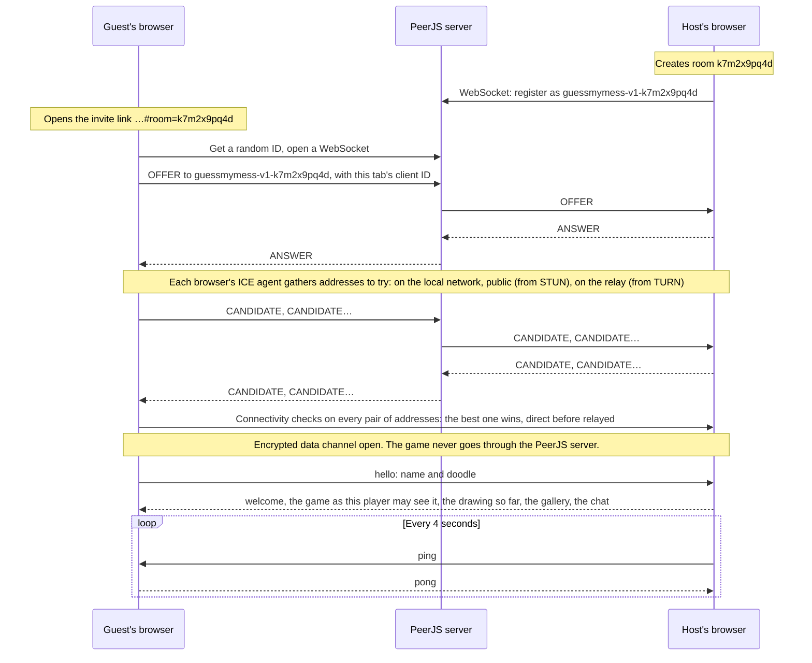

<div align="center">

# Guess My Mess

**Draw it badly. Guess it fast.**

A hand-drawn drawing and guessing party game for teams.<br>
Share a link, play in the browser, no accounts and no server.

**[Play now](https://fredy-mederos.github.io/guess_my_mess/)** · [How to play](#how-to-play) · [How it works](#how-it-works) · [Run it locally](#run-it-locally)

[](https://github.com/fredy-mederos/guess_my_mess/releases/latest)
[](https://github.com/fredy-mederos/guess_my_mess/actions/workflows/deploy.yml)

&nbsp;


</div>

## How to play

1. **Make your doodle.** Open the game, build a character (color, eyes, mouth, hat) and pick a name.
2. **Create a room** and hit **Copy link**. Paste it in your team chat; everyone who opens it joins your room.
3. **Set up the game** (host): word pack language, difficulty, rounds, drawing time and your own team words.
4. **Take turns.** The drawer picks one of a few words and draws it. Everyone else types guesses in the chat.
   Faster guesses score more, and the drawer earns points for every player who gets it
   ([how points work](#how-points-work)).
5. **Vote for the best drawing.** After the last round, every drawing goes up in a gallery and everyone hands
   out hearts: one per round played, up to 3 (not to their own drawings, of course).
6. **Two winners.** The points podium crowns the best guesser, the most-hearted drawing wins Best drawing, and a
   wall of fun stats celebrates the rest: easiest and hardest word, fastest guess, the minimalist who needed just
   two lines, and more.

### How points work

| What happens | Who scores | Points |
| --- | --- | --- |
| You guess the word | You | **100**, plus up to **400** for speed: 400 × the share of the drawing time still left |
| You're the first to guess it this turn | You | **+50** on top |
| Someone guesses your drawing | The drawer | **+75** for every player who gets it |
| A wrong guess, or a "so close!" one | Nobody | 0, and no penalty: guess as often as you like |
| Letter hints show up | Nobody | 0: hints never cost or change points, they only make the word easier as time runs out |
| Hearts in the best-drawing vote | Nobody | 0: hearts pick Best drawing, not the points winner |

In one line: **guess points = 100 + 400 × (time left ÷ drawing time) + 50 if you're first**, rounded to the nearest
5. So the most you can get for one guess is 550 (first, right away), and a guess just before the buzzer is worth
100 (150 if nobody got it before you).

For example, in an 80-second turn: Ana guesses first, after 20 seconds (60 left), and gets 100 + 300 + 50 = **450**.
Bo guesses with 20 seconds left and gets 100 + 100 = **200**. The drawer gets 75 + 75 = **150**.

- **When a turn ends**: as soon as everyone has guessed, or when the time runs out.
- **Letter hints**: nothing shows for the first 30% of the turn, then letters appear one at a time until 90% of the
  turn. "A few" shows up to 30% of the letters, "Lots" up to 50%, and never the whole word.
- **Who wins**: the highest total after the last round, and a tie shares the win. The hall of fame counts those
  wins, plus Best drawing awards.

## Features

- **Private rooms for up to 24 players**: every room gets a random, unguessable link. The room ID lives after
  the `#`, so it never reaches the web server. Stress-tested with 20 players on phones, laptops and tablets,
  including players dropping out and the host reloading mid-game.
- **Word packs**: 600 hand-picked words each in English, Español, Deutsch, Português and Français (easy, medium
  and hard: objects, animals, food, jobs, idioms and some office and car life). The host's device remembers recent
  words, so they don't come back in the next games.
- **Game setup**: word pack language; easy / mixed / medium / hard; 1 to 10 rounds;
  30 to 240 second turns; pick from 1 to 5 words; letter hints; "you're close" hints; custom team words, mixed
  in or on their own.
- **Drawing tools**: pen, marker, ink, spray, neon, rainbow, eraser and fill bucket; 24 colors plus a custom
  picker, brush size, paper color, undo, redo and clear.
- **Fair guessing**: correct answers are hidden from the chat, near misses get a private "so close!", and
  accents, spaces and hyphens don't matter (`arbol` = `árbol`, `standup` = `stand-up`). Players who already
  guessed can keep chatting without spoiling it.
- **Scores and bragging rights**: points by speed with a first-guess bonus, a reveal after every turn, a podium
  with confetti and a hall of fame (wins and best-drawing awards) that persists on the host's device.
- **Best drawing award**: a heart vote over every drawing of the game. The winners are shown big and can be saved
  as full-size images. Drawings travel as strokes (vector data) and are redrawn on each device, so they stay crisp.
- **Fun stats**: easiest / hardest word, fastest guess, sharpest eye, minimalist, most detailed, most colorful,
  second thoughts (undos), so close and wild guesser.
- **Change your look any time**: tap your avatar in the top bar to edit your character or name mid-game.
- **Made for phones too**: on a phone the drawer gets the whole screen (chat tucks away, all tools in reach,
  latest guesses shown under the palette).
- **Hand-drawn look**: notebook paper in light mode, chalkboard in dark mode, reactions and sound effects.
- **Survives reloads**: the host can refresh and the room comes back; guests rejoin and keep their score.

## How it works

The site is just static files, so GitHub Pages can host it. There's no game server to run either: the browser
that creates the room **is the game server**. The other players connect straight to it over
[WebRTC](https://developer.mozilla.org/en-US/docs/Web/API/WebRTC_API), the peer-to-peer technology behind video
calls. A few free public servers help the browsers find each other, or pass the traffic along when they can't
reach each other directly.



| Piece | What it does | What it sees |
| --- | --- | --- |
| **GitHub Pages** | Serves the game files. The [PeerJS](https://peerjs.com) library comes from unpkg, the fonts from Google Fonts. | Someone loading the game. The room ID is after the `#` in the link, which browsers never send. |
| **PeerJS server** (`0.peerjs.com`) | Signaling: every browser keeps a WebSocket open to it and registers an ID, and it passes the connection setup between them. | The IDs (the host's contains the room ID) and the setup messages: network addresses and encryption fingerprints. Never the game. |
| **STUN server** (`stun.l.google.com`) | Tells a browser the public address the internet sees for it, so two browsers behind home routers can reach each other. | Your public IP address. |
| **TURN relay** (`eu-0` / `us-0.turn.peerjs.com`) | Plan B when there's no direct route (mobile data and strict office networks, mostly): forwards the packets between the two browsers. Free and best-effort. | Encrypted packets it can't read. |
| **Host's browser** | Runs the game engine and relays the game to everyone. | Everything: it *is* the game. |

### Joining a room



Finding a route is WebRTC's ICE (Interactive Connectivity Establishment). A direct route works on the same Wi-Fi
and through most home routers; phones on mobile data and strict office networks often need the relay, and when
nothing works the guest is told it's the network (see [Troubleshooting](#troubleshooting)). The data channel is
encrypted end to end (DTLS), so the relay only passes along packets it can't read, and it's reliable and ordered
like TCP, so strokes arrive whole and in order. Messages are plain objects packed in PeerJS's binary format;
anything over 16 KB goes in chunks. A first join keeps knocking for 20 seconds, in case the host was away for a
moment.

### During a game

- **A star around the host.** Every guest has a single connection, to the host. The drawer's strokes, the guesses
  and the chat all go to the host, which passes them on; with 24 players, the host holds 23 connections.
- **Everyone gets their own view.** The engine sends each player only what they're allowed to see: the secret word
  reaches the drawer, the players who already guessed it and, at the reveal, everyone. A right guess never shows up
  in the chat.
- **Drawings travel as strokes**, not pixels: points in board coordinates (0 to 1), sent in batches every 40 ms,
  so a drawing looks the same on a phone and on a 4K screen. Fills, undo, redo, clear and the paper color travel
  the same way, and a player who joins mid-turn gets the drawing so far, 25 strokes per message.
- **Heartbeats.** A link that's quiet for 14 seconds counts as dead. The host marks the player offline, and the
  guest reconnects by itself every 2.5 seconds, for up to 90 seconds, with the same client ID, so it keeps its
  score. A drawer who drops has 8 seconds to come back before the turn moves on.
- **The host must keep the tab open.** Closing it ends the room. A reload is fine: the game is saved in the tab's
  session storage, the room opens again under the same ID (the PeerJS server can hold on to the old one for a few
  seconds, so the host retries), and everyone reconnects and gets the drawing, the gallery and the chat back.

## Run it locally

```bash
python3 serve.py
```

It prints two addresses: `localhost` for this computer and your network IP for phones and laptops on the same
Wi-Fi. Create the room from the network-IP address so the invite link works on the other devices.

## Tests

```bash
node --test
```

Plays real games in headless Chrome: a full 3-player game, the phone layout, the letter hints and joining when
something goes wrong, plus a check of the word packs. All it needs is Node.js 22+ and Google Chrome. There's also
a 20-player stress test and a script that retakes the screenshots above; see [tests/README.md](tests/README.md).

## Releasing

`main` is for work in progress; the `release` branch is what's live. Every push to `release` runs the
[deploy workflow](.github/workflows/deploy.yml), which publishes the game to GitHub Pages:

```bash
git push origin main:release
```

The workflow ships only the game files and stamps every script and stylesheet URL with the commit, so after a
release every player loads the new version instead of a mix of cached old files and new ones.

After a successful deploy, the release is tagged automatically (`v1.0.0`, `v1.1.0`, `v1.2.0`, …) and gets a
[GitHub Release](https://github.com/fredy-mederos/guess_my_mess/releases) listing the commits since the previous
version; the version badge at the top of this page follows it. Every release bumps the minor number. To pick the
number yourself (a patch or a major), tag the commit and push the tag along with it:

```bash
git tag v2.0.0
git push origin main:release v2.0.0
```

## Customize

- **Words**: edit the easy / medium / hard lists in `js/words/en.js`, `es.js`, `de.js`, `pt.js` and `fr.js`.
- **New language**: copy one of those files and register it in `js/words/index.js`.
- **Timing and scoring**: constants at the top of `js/engine.js`.

## Troubleshooting

- **"Found the host, but your devices couldn't connect"**: the two networks can't reach each other, and PeerJS's
  free relay didn't help (it's best-effort). Common with mobile data on both phones, VPNs and office Wi-Fi. Put
  one player on Wi-Fi, or have everyone join the host's phone hotspot.
- **"The host isn't answering"**: phones pause a page that's in the background, so a host who's in another app
  can't let anyone in. The host goes back to the game, and the guest tries again.
- **"Couldn't find that room"**: the host closed their tab, or has been in another app for a while. If it's
  closed, the host creates a new room and shares the new link.
- **Something looks off right after a release**: reload the page so everyone runs the same version.

## Contributing

This is a closed project: **pull requests aren't accepted**. Found a bug, have an idea or a word list to suggest?
[Open an issue](https://github.com/fredy-mederos/guess_my_mess/issues), all feedback is welcome.

## Project layout

```
index.html          page skeleton
css/base.css        themes (notebook / chalkboard), sketchy cards and buttons, home screen
css/game.css        room layout, board, toolbar, chat, overlays, responsive rules
js/main.js          boot and glue between network, engine and UI
js/net.js           PeerJS transport: host star, heartbeats, reconnects
js/engine.js        host-only game logic (the source of truth)
js/board.js         canvas, brushes, fill, undo by replay
js/toolbar.js       the drawer's tools
js/icons.js         hand-drawn line icons
js/avatar.js        doodle avatar parts
js/words/           word packs
js/ui/              home, character editor, lobby, in-game overlays, chat, voting gallery + results
serve.py            local dev server (no caching, prints the LAN address)
tests/              end-to-end tests in headless Chrome, stress test, README screenshots
```

## License

[MIT](LICENSE) © 2026 Fredy Mederos
