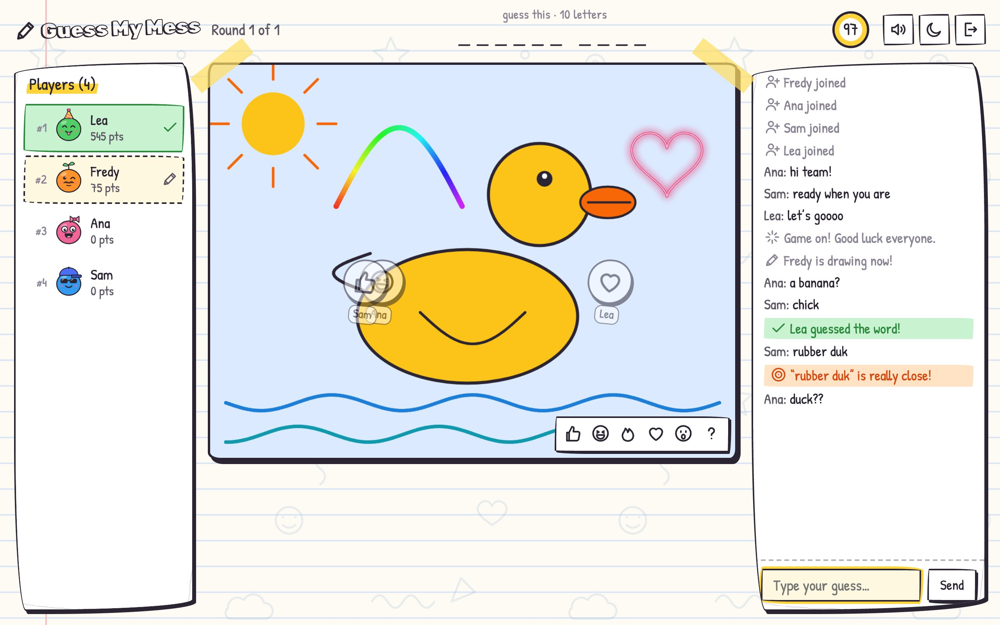
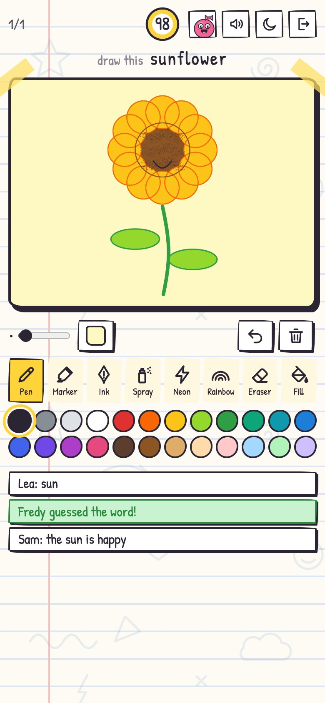

<div align="center">

# Guess My Mess

**Draw it badly. Guess it fast.**

A hand-drawn drawing and guessing party game for teams.<br>
Share a link, play in the browser, no accounts and no server.

**[Play now](https://fredy-mederos.github.io/guess_my_mess/)** · [How to play](#how-to-play) · [How it works](#how-it-works) · [Run it locally](#run-it-locally)

[](https://github.com/fredy-mederos/guess_my_mess/releases/latest)
[](https://github.com/fredy-mederos/guess_my_mess/actions/workflows/deploy.yml)

&nbsp;


</div>

## How to play

1. **Make your doodle.** Open the game, build a character (color, eyes, mouth, hat) and pick a name.
2. **Create a room** and hit **Copy link**. Paste it in your team chat; everyone who opens it joins your room.
3. **Set up the game** (host): word pack language, difficulty, rounds, drawing time and your own team words.
4. **Take turns.** The drawer picks one of a few words and draws it. Everyone else types guesses in the chat.
   Faster guesses score more, and the drawer earns points for every player who gets it.
5. **Vote for the best drawing.** After the last round, every drawing goes up in a gallery and everyone hands
   out hearts: one per round played, up to 3 (not to their own drawings, of course).
6. **Two winners.** The points podium crowns the best guesser, the most-hearted drawing wins Best drawing, and a
   wall of fun stats celebrates the rest: easiest and hardest word, fastest guess, the minimalist who needed just
   two lines, and more.

## Features

- **Private rooms for up to 24 players**: every room gets a random, unguessable link. The room ID lives after
  the `#`, so it never reaches any web server. Stress-tested with 20 players on phones, laptops and tablets,
  including players dropping out and the host reloading mid-game.
- **Word packs**: 600 hand-picked words each in English, Español, Deutsch, Português and Français (easy, medium
  and hard: objects, animals, food, jobs, idioms and some office and car life). The host's device remembers recent
  words, so they don't come back in the next games.
- **Game setup**: word pack language; easy / mixed / medium / hard; 1 to 10 rounds;
  30 to 240 second turns; pick from 1 to 5 words; letter hints; "you're close" hints; custom team words, mixed
  in or on their own.
- **Drawing tools**: pen, marker, ink, spray, neon, rainbow, eraser and fill bucket; 24 colors plus a custom
  picker, brush size, paper color, undo and clear.
- **Fair guessing**: correct answers are hidden from the chat, near misses get a private "so close!", and
  accents, spaces and hyphens don't matter (`arbol` = `árbol`, `standup` = `stand-up`). Players who already
  guessed can keep chatting without spoiling it.
- **Scores and bragging rights**: points by speed with a first-guess bonus, a reveal after every turn, a podium
  with confetti and a hall of fame (wins and best-drawing awards) that persists on the host's device.
- **Best drawing award**: a heart vote over every drawing of the game. The winners are shown big and can be saved
  as full-size images. Drawings travel as strokes (vector data) and are redrawn on each device, so they stay crisp.
- **Fun stats**: easiest / hardest word, fastest guess, sharpest eye, minimalist, most detailed, most colorful,
  second thoughts (undos), so close and wild guesser.
- **Change your look any time**: tap your avatar in the top bar to edit your character or name mid-game.
- **Made for phones too**: on a phone the drawer gets the whole screen (chat tucks away, all tools in reach,
  latest guesses shown under the palette).
- **Hand-drawn look**: notebook paper in light mode, chalkboard in dark mode, reactions and sound effects.
- **Survives reloads**: the host can refresh and the room comes back; guests rejoin and keep their score.

## How it works

The site is just static files, so GitHub Pages can host it. Multiplayer is **peer-to-peer** over WebRTC:

```
              ┌──────── host's browser ────────┐
   guest <--> │  game engine: turns, timer,    │ <--> guest
   guest <--> │  secret word, guesses, scores  │ <--> guest
              └────────────────────────────────┘
```

- The browser that creates the room **is the game server**. It holds the secret word and sends each player only
  what they're allowed to see.
- The free public [PeerJS](https://peerjs.com) server only introduces browsers to each other. Drawings, guesses and
  chat travel directly between players, encrypted.
- **The host must keep the tab open.** Closing it ends the room; a reload is fine.

## Run it locally

```bash
python3 serve.py
```

It prints two addresses: `localhost` for this computer and your network IP for phones and laptops on the same
Wi-Fi. Create the room from the network-IP address so the invite link works on the other devices.

## Tests

```bash
node --test
```

Plays real games in headless Chrome: a full 3-player game, the phone layout and the letter hints, plus a check
of the word packs. All it needs is Node.js 22+ and Google Chrome. There's also a 20-player stress test and a
script that retakes the screenshots above; see [tests/README.md](tests/README.md).

## Releasing

`main` is for work in progress; the `release` branch is what's live. Every push to `release` runs the
[deploy workflow](.github/workflows/deploy.yml), which publishes the game to GitHub Pages:

```bash
git push origin main:release
```

The workflow ships only the game files and stamps every script and stylesheet URL with the commit, so after a
release every player loads the new version instead of a mix of cached old files and new ones.

After a successful deploy, the release is tagged automatically (`v1.0.0`, `v1.1.0`, `v1.2.0`, …) and gets a
[GitHub Release](https://github.com/fredy-mederos/guess_my_mess/releases) listing the commits since the previous
version; the version badge at the top of this page follows it. Every release bumps the minor number. To pick the
number yourself (a patch or a major), tag the commit and push the tag along with it:

```bash
git tag v2.0.0
git push origin main:release v2.0.0
```

## Customize

- **Words**: edit the easy / medium / hard lists in `js/words/en.js`, `es.js`, `de.js`, `pt.js` and `fr.js`.
- **New language**: copy one of those files and register it in `js/words/index.js`.
- **Timing and scoring**: constants at the top of `js/engine.js`.

## Troubleshooting

- **A teammate can't join**: some corporate networks and VPNs block peer-to-peer connections. Try without the
  VPN or from another network.
- **"That room doesn't exist anymore"**: the host closed their tab. The host creates a new room and shares the new
  link.
- **Something looks off right after a release**: reload the page so everyone runs the same version.

## Contributing

This is a closed project: **pull requests aren't accepted**. Found a bug, have an idea or a word list to suggest?
[Open an issue](https://github.com/fredy-mederos/guess_my_mess/issues), all feedback is welcome.

## Project layout

```
index.html          page skeleton
css/base.css        themes (notebook / chalkboard), sketchy cards and buttons, home screen
css/game.css        room layout, board, toolbar, chat, overlays, responsive rules
js/main.js          boot and glue between network, engine and UI
js/net.js           PeerJS transport: host star, heartbeats, reconnects
js/engine.js        host-only game logic (the source of truth)
js/board.js         canvas, brushes, fill, undo by replay
js/toolbar.js       the drawer's tools
js/icons.js         hand-drawn line icons
js/avatar.js        doodle avatar parts
js/words/           word packs
js/ui/              home, character editor, lobby, in-game overlays, chat, voting gallery + results
serve.py            local dev server (no caching, prints the LAN address)
tests/              end-to-end tests in headless Chrome, stress test, README screenshots
```

## License

[MIT](LICENSE) © 2026 Fredy Mederos
